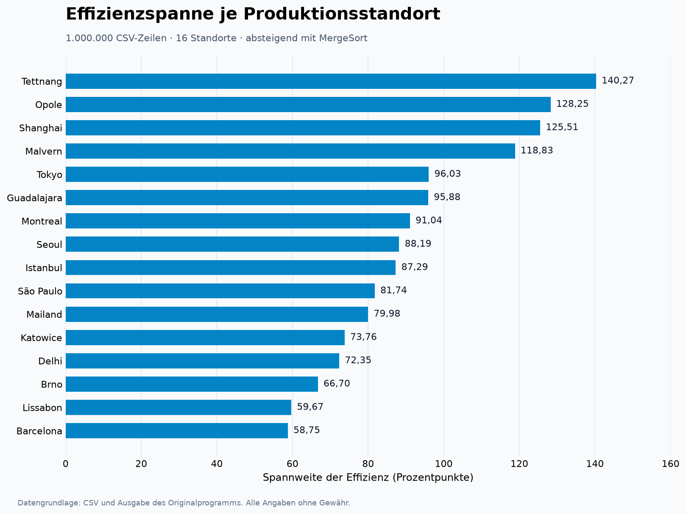

# CSV-Auswertung mit MergeSort

**Java · Datenaggregation · Sortieralgorithmen**

Eine Million CSV-Zeilen werden nach Produktionsstandort zusammengefasst. Das Programm berechnet die kleinste und größte Effizienz, ihre Spannweite und den durchschnittlichen Gewinn. Anschließend ordnet MergeSort die Standorte absteigend nach der Effizienzspanne.



[Projekt und Technik](docs/PROJEKT.md) · [Ergebnisse](docs/GALERIE.md) · [Quellcode herunterladen](https://github.com/Kennatris/ProjektarbeitMergeSort/archive/refs/heads/master.zip)

## Funktionsumfang

- CSV-Dateien aus dem Ordner `CSV` einlesen.
- Dezimalkommas, Prozent- und Eurozeichen verarbeiten.
- Werte je Standort zusammenfassen und einen Fortschrittsbalken anzeigen.
- Aggregierte Daten vor und nach der Sortierung in der Konsole ausgeben.
- Die Standortliste mit einem selbst implementierten MergeSort sortieren.


## Start

Das Programm besteht aus fünf Java-Dateien und benötigt keine zusätzlichen Bibliotheken. Im Projektordner:

```powershell
New-Item -ItemType Directory -Force build | Out-Null
javac -encoding UTF-8 -d build src/*.java
java -Xmx1g -cp build Main
```

Die mitgelieferte CSV enthält 1.000.000 Datenzeilen für 16 Standorte. Die Grafik stellt die Werte aus der Programmausgabe dar. [Dateiformat und Algorithmus](docs/PROJEKT.md).

> **Hinweis:** Dokumentation und Zusammenfassung wurden automatisiert durch einen Agenten erstellt und dienen der Veranschaulichung. Der Programmcode ist unverändert. Alle Angaben und Downloads ohne Gewähr.
